# Rumo

**Tarefas com GTD completo, agenda, finanças com Open Finance, hábitos e foco — num só app.**
Funciona no navegador (PWA, offline) e no Windows (.exe). Seus dados ficam no seu dispositivo.

[**▶ Testar a demo ao vivo**](https://rumo-demo-phi.vercel.app) · [**⬇ Baixar para Windows**](https://rumo-demo-phi.vercel.app/baixar) · [Novidades](CHANGELOG.md)

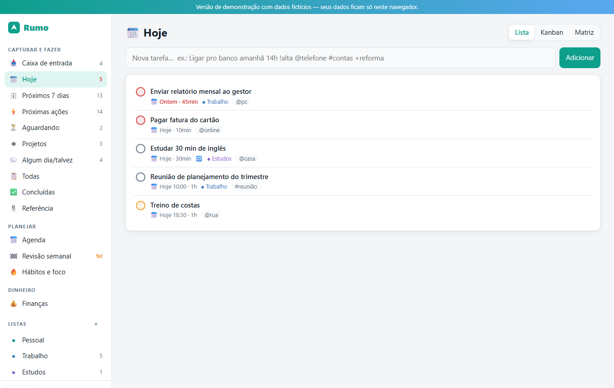

## Por que o Rumo

A maioria das pessoas usa um app para tarefas, outro para o calendário, outro para o dinheiro e uma planilha para o resto. O Rumo junta tudo e segue um método de verdade — o **GTD** — em vez de ser só uma lista.

| | |
|---|---|
| 📥 **Capture rápido** | Escreva do jeito que fala: `Ligar pro banco amanhã 14h !alta @telefone #contas +reforma` — data, hora, prioridade, contexto, tag e projeto são entendidos sozinhos. |
| ⚡ **Esclareça sem pensar** | O assistente da Caixa de entrada pergunta: exige ação? leva 2 minutos? é um projeto? é de outra pessoa? E já organiza. |
| 🧭 **Revise toda semana** | Revisão semanal guiada: zere a caixa de entrada, cobre o que está "Aguardando" e destrave projetos sem próxima ação. |
| 🗓 **Planeje o dia sozinho** | "Planejar meu dia" encaixa as tarefas nos horários livres da agenda, respeitando prioridade e seu expediente. |
| 💰 **Dinheiro no mesmo lugar** | Contas, cartões (fatura e limite), orçamento, metas, previsão de saldo e **Open Finance** para trazer o extrato dos bancos. |
| 🔥 **Hábitos e foco** | Sequências, mapa de calor e Pomodoro ligado às suas tarefas. |

## Telas

| Processar a Caixa de entrada | Kanban | Matriz de Eisenhower |
|---|---|---|
| 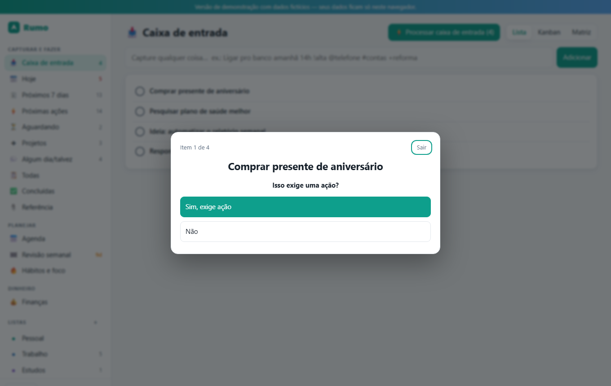 | 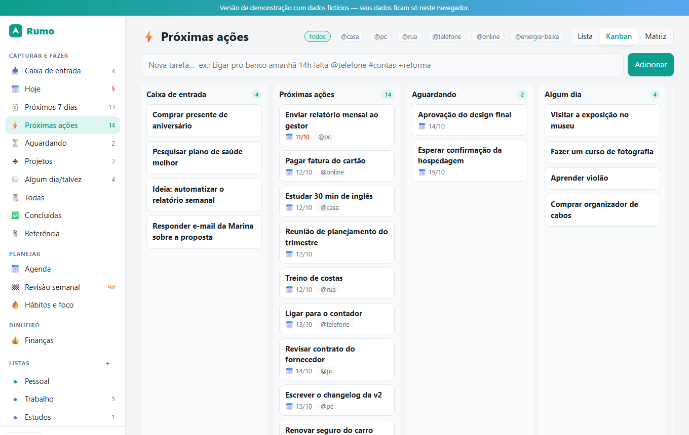 | 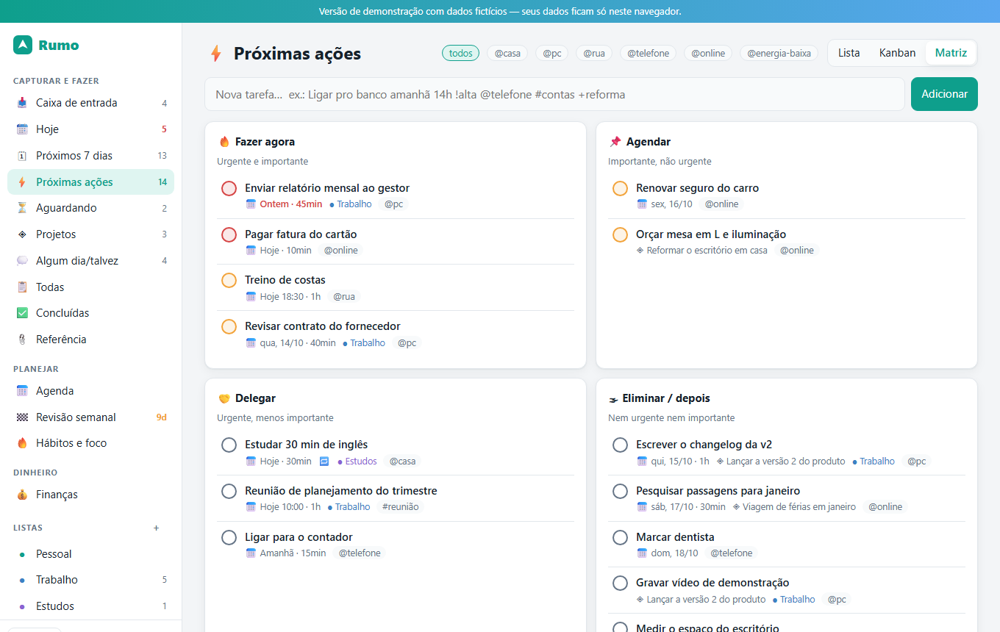 |

| Agenda do dia | Projetos | Revisão semanal |
|---|---|---|
| 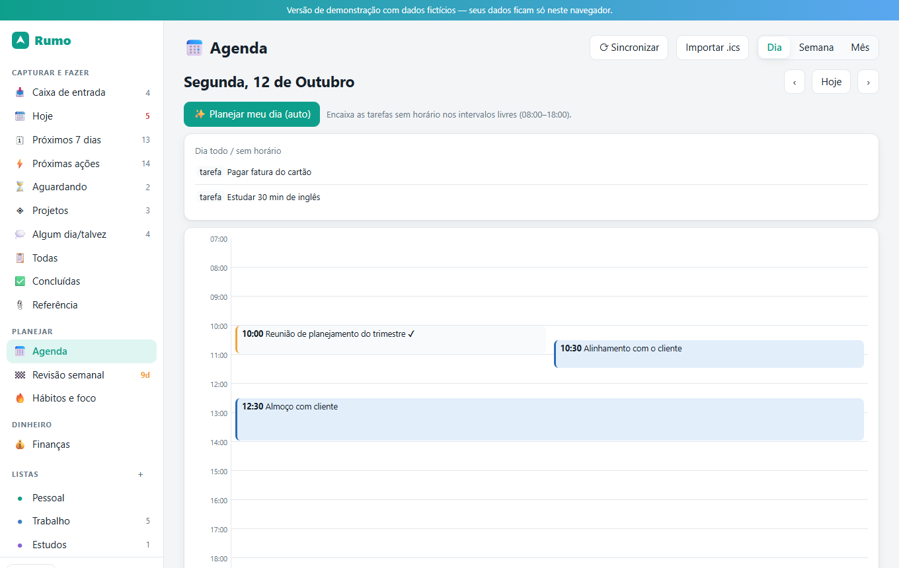 | 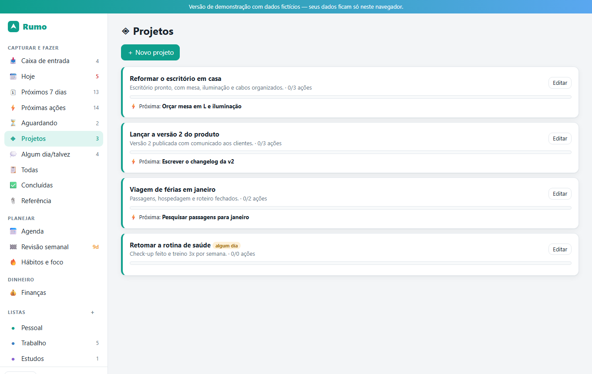 | 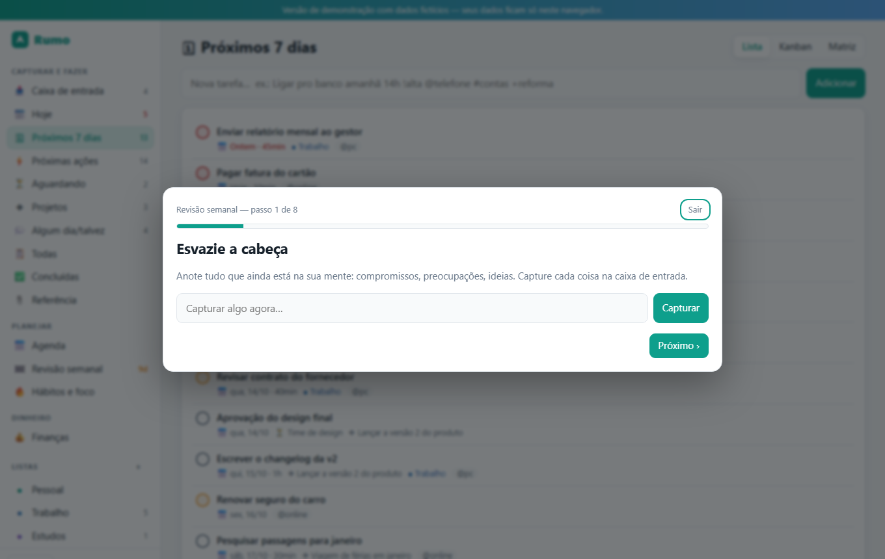 |

| Finanças | Relatórios | Cartões (tema escuro) |
|---|---|---|
| 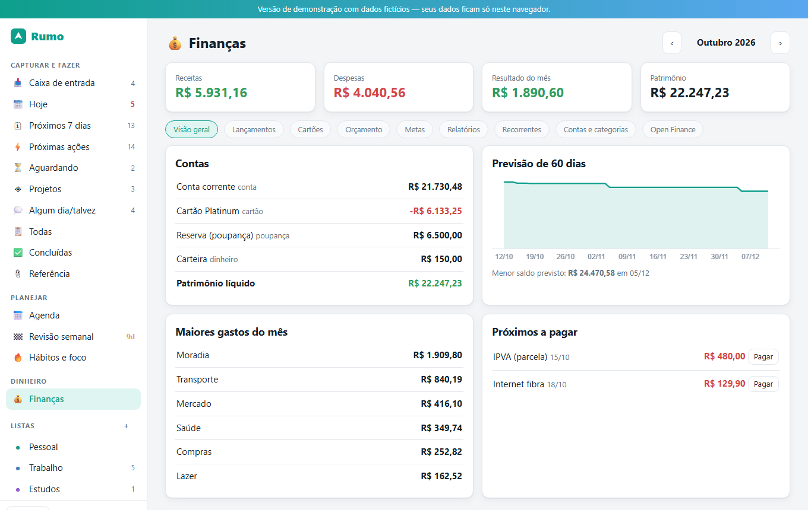 | 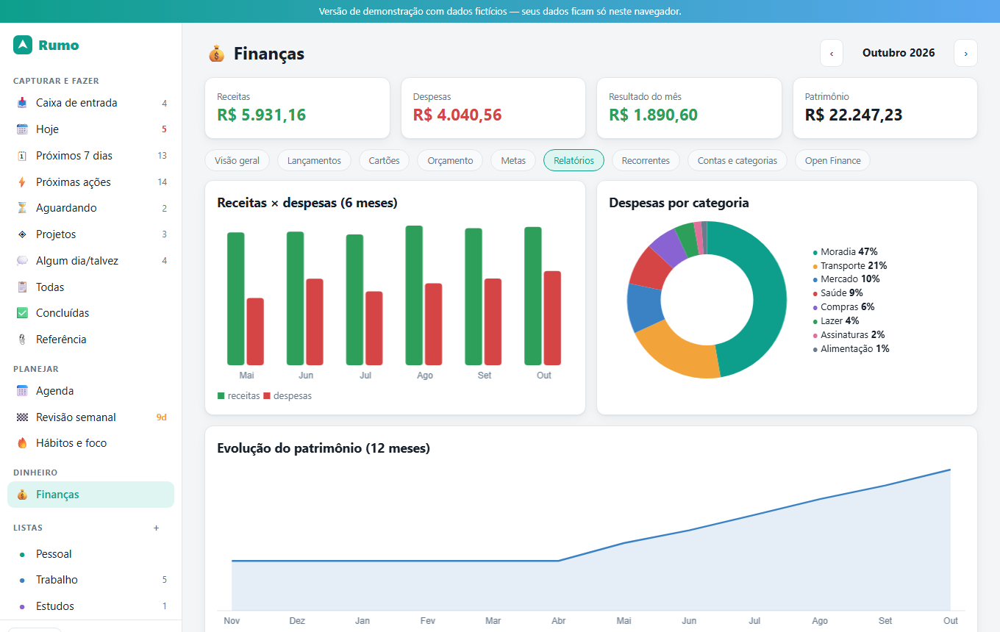 | 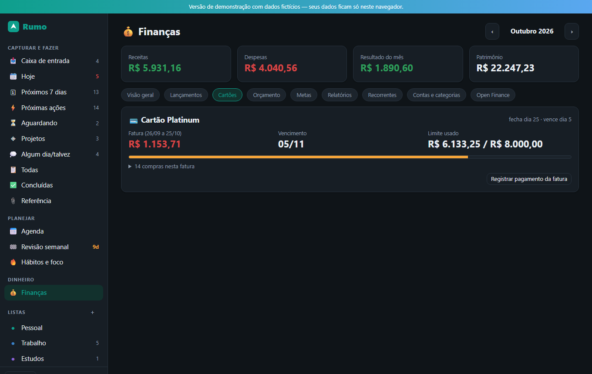 |

| Hábitos | Integrações | Paleta de comandos (Ctrl+K) |
|---|---|---|
| 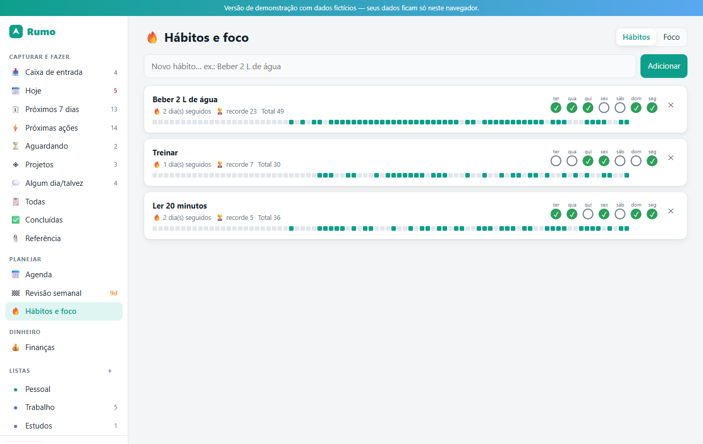 | 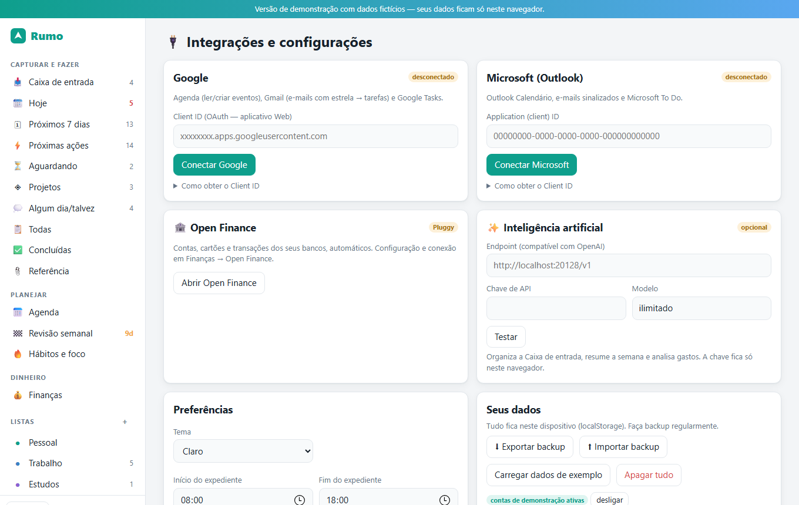 | 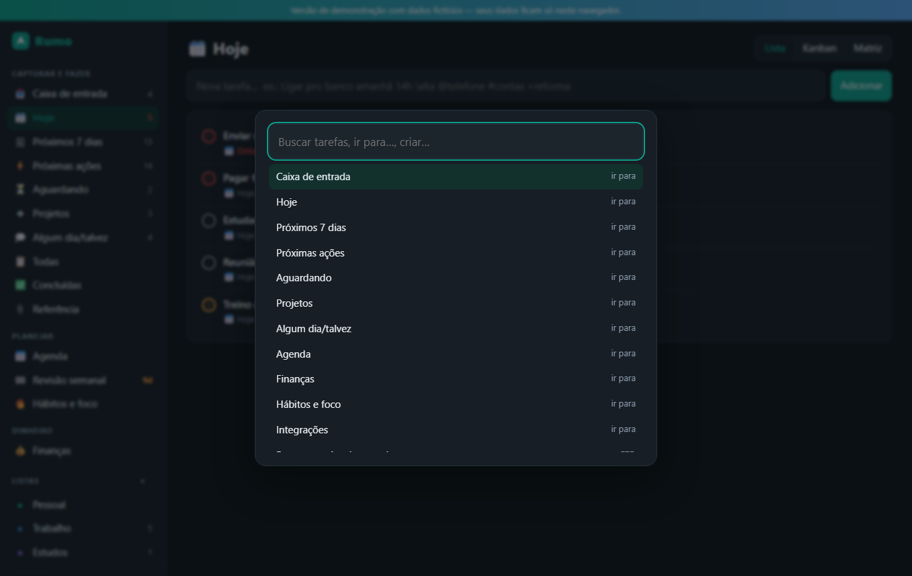 |

## Recursos

**GTD** · Caixa de entrada, Próximas ações por contexto (@casa, @pc, @rua…), Aguardando, Projetos com resultado e próxima ação, Algum dia/talvez, Referência, Tickler (ocultar até a data), Revisão semanal.

**Tarefas** · Lista, Kanban com arrastar, Matriz de Eisenhower, subtarefas, prioridades, repetição, tags, desfazer, lembretes, busca e paleta de comandos.

**Agenda** · Dia, semana e mês · Google Agenda e Outlook · importação de `.ics` · criar evento a partir de uma tarefa · planejamento automático do dia.

**Integrações** · Google (Agenda, Gmail com estrela → tarefa, Google Tasks) · Microsoft (Outlook, e-mails sinalizados, To Do) · IA opcional (qualquer endpoint compatível com OpenAI) para organizar a Caixa de entrada, resumir a semana e analisar gastos.

**Finanças** · Contas e cartões · parcelas e transferências · recorrências · orçamento por categoria · metas com "quanto guardar por mês" · previsão de saldo · relatórios (receitas × despesas, categorias, patrimônio) · importação OFX/CSV com detecção de duplicados · regras de categorização · Open Finance.

## Privacidade

- Tudo fica **no seu dispositivo**. Não existe servidor do Rumo recebendo seus dados.
- Google e Microsoft usam **o seu próprio** cadastro OAuth; os tokens ficam só no seu aparelho.
- No Open Finance, as chaves do agregador ficam no backend local; o app nunca vê a senha do seu banco.

## Baixar

| Arquivo | Para quê |
|---|---|
| [`Rumo-Setup-2.0.0.exe`](https://github.com/srlorenzos/rumo-showcase/releases/download/v2.0.0/Rumo-Setup-2.0.0.exe) | Instalador (atalho no menu iniciar) |
| [`Rumo-Portable-2.0.0.exe`](https://github.com/srlorenzos/rumo-showcase/releases/download/v2.0.0/Rumo-Portable-2.0.0.exe) | Versão portátil, sem instalar |

Os hashes SHA-256 estão em [`SHA256SUMS.txt`](https://github.com/srlorenzos/rumo-showcase/releases/download/v2.0.0/SHA256SUMS.txt).
O app ainda **não é assinado digitalmente**: o Windows SmartScreen pode avisar na primeira execução ("Mais informações" → "Executar assim mesmo").

## O que precisa de configuração sua

Para respeitar a sua privacidade, algumas integrações usam credenciais **suas** (nenhuma vem embutida):

- **Google / Microsoft:** crie um Client ID OAuth gratuito (passo a passo dentro do app, em *Integrações*).
- **Open Finance:** conta gratuita em um agregador regulado (Pluggy) e duas variáveis de ambiente.
- **IA:** um endpoint compatível com OpenAI (opcional).

Sem nada disso o Rumo funciona por completo: tarefas, GTD, agenda local, finanças e hábitos.

## Roadmap

- Sincronização entre dispositivos (criptografada de ponta a ponta)
- Aplicativo móvel
- Compartilhar listas e projetos
- Anexos e e-mail de captura

---

Feito por [Eduardo Lorenzo](https://github.com/srlorenzos). O código-fonte é privado; esta página é a vitrine pública.
